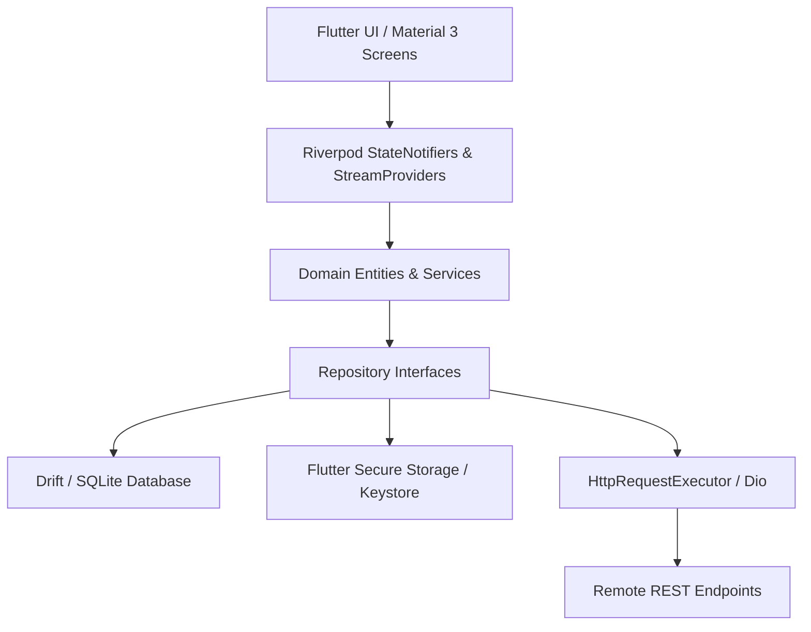

# APIForge Mobile ⚡

[](https://github.com/apiforge/apiforge-mobile/actions/workflows/ci.yml)
[](https://flutter.dev)
[](https://dart.dev)
[](LICENSE)

**APIForge** is an Android-first, cross-platform mobile REST API testing client built from the ground up for software engineers, backend developers, QA professionals, and computer science students. Built with Flutter, Material 3, Riverpod, and Drift (SQLite), APIForge delivers a responsive, offline-first developer client that lets you compose HTTP requests, execute network operations, inspect syntax-highlighted responses, manage hierarchical collections, substitute environment variables, securely store credentials in hardware keystores, and audit request history with one-tap replay.

---

## 📱 Features

- **🚀 Flexible Request Builder**:
  - Full HTTP verb support: `GET`, `POST`, `PUT`, `PATCH`, `DELETE`, `HEAD`, `OPTIONS`.
  - Dynamic key-value editors for Query Parameters and Headers with toggleable rows.
  - Multi-type body editor: `none`, `raw (JSON)` with auto 2-space formatter, `raw (Text)`, and `x-www-form-urlencoded`.
  - In-flight request cancellation via Dio `CancelToken`.
  - One-tap cURL command generation with optional secret masking.
- **🔍 Deep Response Inspector**:
  - Semantic status badges with HTTP status messages (e.g., `200 OK`, `404 Not Found`, `500 Internal Server Error`).
  - Formatted JSON response viewer featuring a custom theme-aware syntax highlighter (`TextSpan` token tree).
  - Raw response text and response headers inspector with sensitive cookie/token masking.
  - Round-trip latency (ms) and payload size metrics (B, KB, MB).
  - Structured diagnostics for network failures, timeouts, and TLS errors with a dedicated Retry action.
- **📂 Hierarchical SQLite Collections**:
  - Structured local persistence powered by **Drift** and **SQLite**.
  - Foreign key cascades and atomic multi-row transactions (`PRAGMA foreign_keys = ON;`).
  - Search collections and saved requests by name, URL, or HTTP method.
  - One-tap duplicate with `(Copy)` suffix and destructive confirmation dialogs.
- **🌐 Environments & Variable Substitution**:
  - Seeded environments: `Local`, `Development`, and `Production`.
  - Variable substitution engine supporting `{{baseUrl}}`, `{{token}}`, and custom variables across URL, headers, and request body.
  - Precedence hierarchy: Request-local > Environment-level > Global defaults.
  - Unresolved variable detection with visible diagnostics.
- **🛡️ Hardware-Backed Secure Storage**:
  - Sensitive environment variables and authentication tokens are encrypted via `FlutterSecureStorage` (Android Keystore / EncryptedSharedPreferences; iOS Keychain).
  - Relational SQLite tables store only opaque UUID references (`secretRefId`) and empty strings for secret values.
  - Strips credentials automatically when following cross-host redirects.
- **📜 Request History & Audit**:
  - Auto-logs every executed request with timestamp, status, latency, headers, and payload size.
  - Opt-in request body persistence (off by default to prevent credential leakage).
  - Configurable FIFO retention limit (default 100 entries with automated pruning).
  - One-tap replay: loads any history record directly into the Request Builder.
- **🔄 Import & Export**:
  - **APIForge JSON v1**: Versioned interchange format with mandatory credential sanitization.
  - **Postman Collection v2.1 Importer**: Safely parses collections, nested folders, headers, query params, auth, and bodies while strictly discarding executable scripts (`event`, `prerequest`, `test`).

---

## 🏗️ Architecture & Technology Stack

| Layer | Technology | Rationale |
|---|---|---|
| **Language & SDK** | Dart 3.12.2 / Flutter 3.44.6 | Modern null-safety, records, patterns, stable engine |
| **Design System** | Material 3 (Light & Dark Slate) | Adaptive tokens, high-contrast badges, responsive layout |
| **State Management** | Riverpod 2.x | Compile-safe dependency injection, testable StateNotifiers |
| **Navigation** | GoRouter 14.x | Declarative routing with `StatefulShellRoute.indexedStack` |
| **HTTP Networking** | Dio 5.x | Custom interceptors, `CancelToken`, and unthrottled status inspection |
| **Relational Storage** | Drift 2.x + SQLite | Type-safe SQL queries, reactive streams, foreign key cascades |
| **Secure KeyStore** | Flutter Secure Storage 9.x | AES-256 GCM encrypted keystore isolation for API secrets |

### System Architecture Diagram



---

## 🚀 Getting Started

### Prerequisites

- Flutter SDK `^3.44.0`
- Dart SDK `^3.12.0`
- Android Studio / VS Code with Flutter extension
- Android SDK 34+ or Android Emulator (API 34+)

### Installation & Run

1. Clone the repository:
   ```bash
   git clone https://github.com/apiforge/apiforge-mobile.git
   cd apiforge-mobile
   ```

2. Fetch dependencies:
   ```bash
   flutter pub get
   ```

3. Run code generation (for Drift database classes):
   ```bash
   dart run build_runner build --delete-conflicting-outputs
   ```

4. Launch the application on an emulator or connected device:
   ```bash
   flutter run
   ```

For web builds, `web/sqlite3.wasm` and `web/drift_worker.js` provide Drift's
SQLite runtime. Keep these assets compatible with the `drift` and `sqlite3`
versions in `pubspec.lock` when upgrading those dependencies.

---

## 🧪 Testing & Quality Assurance

APIForge maintains a comprehensive, zero-network-dependency automated test suite:

```bash
# Check formatting
dart format --output=none --set-exit-if-changed .

# Static analysis
flutter analyze

# Run all unit, repository, widget, and end-to-end tests
flutter test --coverage
```

Test coverage includes:
- **Unit Tests**: URL validation, SecretRedactor sanitization, cURL generation, Variable substitution engine, AuthHeaderGenerator cross-host redirect safety, and JsonSyntaxHighlighter tokenization.
- **Repository Tests**: SQLite CRUD, foreign key cascade deletions, environment variables, secure storage hardware abstraction, and FIFO history pruning using in-memory databases (`NativeDatabase.memory()`).
- **Import/Export Tests**: APIForge JSON v1 roundtrip verification, Postman Collection v2.1 nested folder parsing, and malicious script discarding.
- **Widget & E2E Tests**: Response inspector rendering, error badge states, and end-to-end flow test (Create -> Send -> Inspect -> Save -> History -> Replay).

---

## 🔒 Security & Privacy Guarantees

1. **Hardware-Backed Secret Storage**: Sensitive values (Bearer tokens, Basic passwords, API keys) are stored in Android Keystore / iOS Keychain. The SQLite database stores only empty strings and opaque UUID references.
2. **Strict Export Redaction**: When exporting collections or environments, secret variables and Authorization headers are automatically redacted with `[REDACTED]` or `[SECRET_REDACTED]`.
3. **Opt-In Body Persistence**: Request bodies in history logs are not saved by default. Users must explicitly enable body persistence in Settings.
4. **Postman Sandbox Safety**: When importing external Postman collections, all JavaScript test scripts and pre-request scripts are completely ignored and discarded to prevent malicious payload execution.

---

## 📄 License

Distributed under the MIT License. See `LICENSE` for more information.
